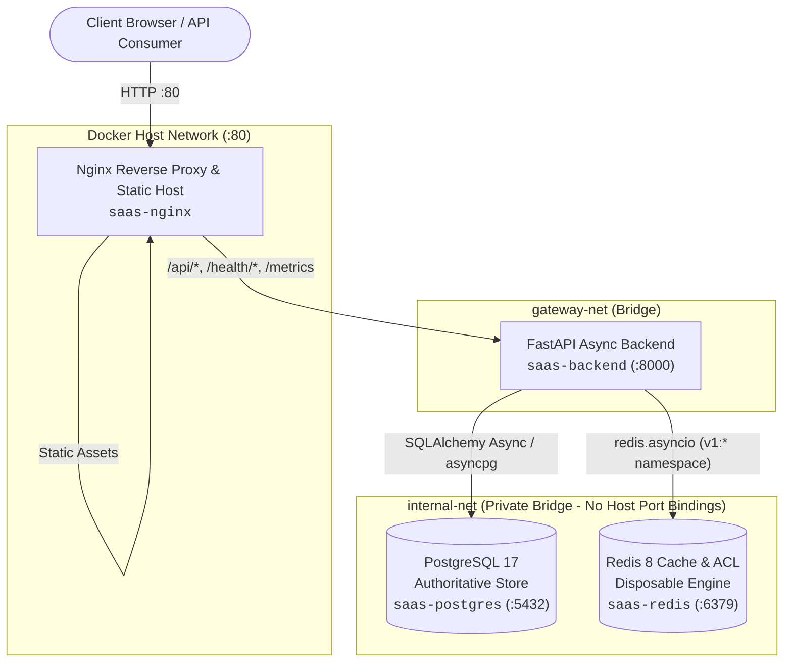
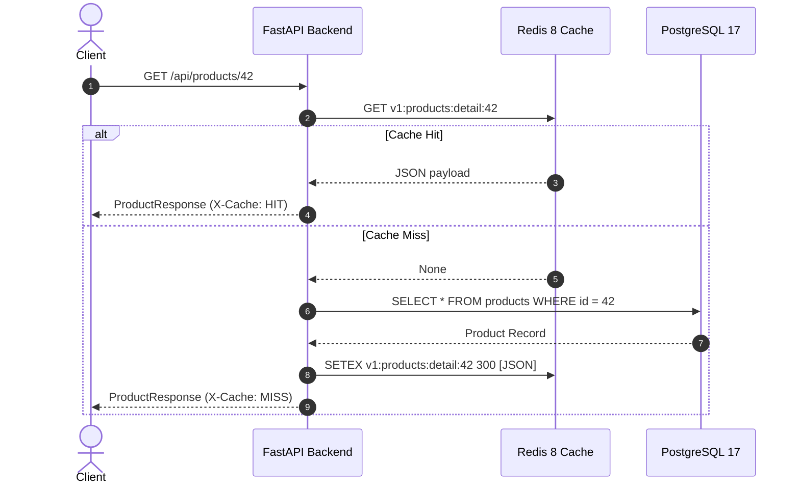

# Redis Product Manager

[](https://python.org)
[](https://fastapi.tiangolo.com)
[](https://www.postgresql.org)
[](https://redis.io)
[](https://react.dev)
[](https://www.typescriptlang.org)
[](https://nginx.org)
[](LICENSE)

A production-grade, full-stack SaaS product management platform demonstrating high-performance sub-millisecond **Redis 8** cache-aside architecture paired with **PostgreSQL 17** as the ACID authoritative source of truth. Built with a modern **React 19** frontend, **FastAPI** asynchronous backend, and reverse-proxied via **Nginx** inside an isolated multi-container Docker environment.

---

## Architecture Overview



### Core Architectural Invariants

1. **PostgreSQL is the Authoritative Source of Truth:**
   - Permanent records and financial precision reside strictly in PostgreSQL 17 using exact `DECIMAL(12, 2)` representations (Python `Decimal` end-to-end, preventing floating-point rounding errors).
   - Database-level check constraints enforce business invariants (`ck_product_price_non_negative`, `ck_product_stock_non_negative`).

2. **Redis 8 as a Disposable Cache & Counter Engine:**
   - Product details (`TTL 300s`), filtered product lists (`TTL 120s`), and dashboard aggregations (`TTL 120s`) are cached in Redis.
   - Redis data is entirely disposable; any cache miss seamlessly repopulates from PostgreSQL.

3. **Generation-Based Cache Invalidation ($O(1)$ Complexity):**
   - Paginated list queries and dashboard statistics incorporate namespace generation numbers (e.g., `v1:products:list:gen:{generation}:...`).
   - Mutations atomically increment generation counters using Lua scripts, instantly invalidating stale queries without costly or dangerous `KEYS` or `SCAN` iterations.

4. **Resilient Graceful Degradation:**
   - Database writes commit before cache invalidation attempts. A Redis failure never rolls back or fails a committed transaction.
   - In the event of a total Redis outage, the backend automatically logs degradation and falls back to serving reads and mutations directly from PostgreSQL. Readiness probes report HTTP 200 with `redis: degraded`.

5. **Defense-in-Depth Security:**
   - **Zero Port Exposure:** PostgreSQL and Redis ports are bound exclusively to the private `internal-net`. Only Nginx publishes port 80 to the host.
   - **Redis 8 ACLs:** The `default` Redis user is disabled. Application workloads authenticate as `app`, constrained strictly to key pattern `~v1:*` and safe command categories (`-@admin -@dangerous`). Health probes authenticate as `healthcheck` restricted exclusively to `+ping`.
   - **Atomic Lua Rate Limiting:** Fixed-window rate limiting evaluates counters and expirations atomically via Lua scripts, preventing orphan keys without TTL.
   - **Security Headers:** Nginx enforces `X-Frame-Options: SAMEORIGIN`, `X-Content-Type-Options: nosniff`, and Referrer policies.

6. **Observability & Health Probing:**
   - Kubernetes/container-compatible `/health/live` (process liveness) and `/health/ready` (dependency checks with PostgreSQL and Redis latency measurements).
   - Prometheus metrics exposition at `/metrics` tracking request latency, cache hit/miss rates, active rate-limit tokens, and database connection pool gauges.
   - Distributed request tracing via incoming or auto-generated `X-Request-ID` headers propagated across logging and response headers.

---

## Repository Structure

```text
.
├── compose.yaml              # Local development multi-container orchestration
├── compose.prod.yaml         # Production overrides (resource limits, log rotation)
├── .env.sample               # Environment configuration template
├── .gitignore                # Git exclusion rules
├── .dockerignore             # Docker build context exclusions
├── LICENSE                   # MIT License
├── README.md                 # Project documentation
├── backend/                  # FastAPI Application
│   ├── alembic/              # Database migration versions and environment
│   ├── alembic.ini           # Alembic configuration
│   ├── app/
│   │   ├── cache/            # Cache keys builder and invalidation policies
│   │   ├── core/             # Structured logging and configuration
│   │   ├── database/         # Async SQLAlchemy engine and session makers
│   │   ├── middleware/       # Request correlation and Prometheus metrics
│   │   ├── models/           # SQLAlchemy ORM models
│   │   ├── routers/          # API route definitions (products, dashboard, health, metrics)
│   │   ├── schemas/          # Pydantic v2 validation models
│   │   ├── services/         # Business logic and Redis service wrapper
│   │   ├── config.py         # Type-safe environment settings
│   │   └── main.py           # Application entry point and lifespan manager
│   ├── tests/                # Automated pytest integration and unit test suite
│   ├── Dockerfile            # Non-root multi-stage Python 3.12 container
│   ├── pytest.ini            # Pytest configuration
│   └── requirements.txt      # Pinned Python backend dependencies
├── frontend/                 # React 19 Frontend Application
│   ├── src/
│   │   ├── components/       # Reusable UI components (ProductModal, etc.)
│   │   ├── context/          # ThemeContext (Dark/Light mode)
│   │   ├── pages/            # View pages (Catalogue, ProductDetail, Dashboard)
│   │   ├── services/         # Axios client and API wrappers
│   │   ├── types/            # TypeScript domain interfaces
│   │   ├── utils/            # Decimal-safe currency and date formatters
│   │   ├── App.tsx           # App shell and client-side routing
│   │   ├── index.css         # Meta design system and CSS variables
│   │   └── main.tsx          # React application entry point
│   ├── tests/                # Vitest unit test suite
│   ├── index.html            # HTML entry point with inline anti-flash theme script
│   ├── package.json          # Node dependencies and scripts
│   ├── tsconfig.json         # TypeScript configuration
│   └── vite.config.ts        # Vite development server and proxy configuration
├── nginx/                    # Reverse Proxy Gateway
│   ├── nginx.conf            # Proxy routing, gzip compression, SPA fallback
│   └── Dockerfile            # Multi-stage frontend build & Nginx runtime
├── redis/                    # Redis 8 Configuration
│   ├── redis.conf            # Memory boundaries, volatile-lru eviction
│   └── users.acl             # Least-privilege ACL rules and SHA-256 hashes
└── scripts/                  # Operational & Automation Tooling
    ├── backup-postgres.sh    # Automated compressed PostgreSQL dump with SHA-256
    ├── restore-postgres.sh   # Verified disaster recovery database restore
    └── smoke-test.sh         # End-to-end production smoke and resilience suite
```

---

## Quick Start

### Prerequisites

- [Docker Engine](https://docs.docker.com/engine/install/) (v24.0+)
- [Docker Compose](https://docs.docker.com/compose/) (v2.20+)

### 1. Configure Environment

Copy `.env.sample` to `.env`. For local development, the default fallback parameters in `compose.yaml` work out-of-the-box:

```bash
cp .env.sample .env
```

### 2. Start Application Stack

Build and start all 4 services in detached mode:

```bash
docker compose up -d --build
```

Verify that all containers are healthy:

```bash
docker compose ps
```

| Container | Image | Port / Mapping | Health Check |
|---|---|---|---|
| `saas-nginx` | `redis-product-manager-nginx` | `0.0.0.0:80->80` | `curl -f http://localhost:80/health/live` |
| `saas-backend` | `redis-product-manager-backend` | Internal (`:8000`) | `curl -f http://localhost:8000/health/live` |
| `saas-postgres` | `postgres:17-alpine` | Internal (`:5432`) | `pg_isready -U app_user -d saas_products` |
| `saas-redis` | `redis:8-alpine` | Internal (`:6379`) | `redis-cli --user healthcheck ping` |

### 3. Access Services

- **Web Application (SPA):** [http://localhost/](http://localhost/)
- **Product API:** [http://localhost/api/products](http://localhost/api/products)
- **Dashboard Stats:** [http://localhost/api/dashboard/stats](http://localhost/api/dashboard/stats)
- **Readiness Health Probe:** [http://localhost/health/ready](http://localhost/health/ready)
- **Prometheus Metrics:** [http://localhost/metrics](http://localhost/metrics)

### 4. Useful Commands

- **Stream live logs across all containers:**
  ```bash
  docker compose logs -f
  ```
- **Stream logs for a specific service (e.g. backend):**
  ```bash
  docker compose logs -f backend
  ```
- **Stop all services:**
  ```bash
  docker compose down
  ```
- **Start in production mode (applies resource limits & log rotation):**
  ```bash
  docker compose -f compose.yaml -f compose.prod.yaml up -d
  ```

---

## API Reference

### Products API (`/api/products`)

| Method | Endpoint | Description | Rate Limit |
|---|---|---|---|
| `POST` | `/api/products` | Create a new product; invalidates list and dashboard caches | 20 req / 60s |
| `GET` | `/api/products` | List products with pagination, category filter, and sorting (`TTL 120s`) | Standard |
| `GET` | `/api/products/{id}` | Retrieve product details by ID (`TTL 300s`) | Standard |
| `PUT` | `/api/products/{id}` | Update product details; invalidates detail and list caches | 20 req / 60s |
| `DELETE` | `/api/products/{id}` | Delete product; invalidates detail and list caches | 20 req / 60s |

#### Example: Create Product

```bash
curl -X POST http://localhost/api/products \
  -H "Content-Type: application/json" \
  -d '{
    "name": "Enterprise Quest Headset",
    "category": "Hardware",
    "price": "499.99",
    "stock": 50
  }'
```

### Dashboard API (`/api/dashboard`)

| Method | Endpoint | Description | Cache |
|---|---|---|---|
| `GET` | `/api/dashboard/stats` | Aggregate metrics (total inventory value, average price, low-stock count, category breakdown) | `TTL 120s` |

### Health & Observability (`/health`, `/metrics`)

| Method | Endpoint | Description | Response Codes |
|---|---|---|---|
| `GET` | `/health/live` | Process liveness check | `200 OK` |
| `GET` | `/health/ready` | Deep readiness probe checking PostgreSQL & Redis connectivity and latencies | `200 OK` (healthy or degraded), `503` (database down) |
| `GET` | `/metrics` | Prometheus metrics scrape endpoint | `200 OK` |

---

## Caching Strategy

The caching architecture implements a cache-aside pattern designed to eliminate race conditions and avoid heavy Redis commands:



### Key Namespaces

| Namespace | Key Pattern | TTL | Invalidation Mechanism |
|---|---|---|---|
| **Product Detail** | `v1:products:detail:{id}` | 300s | Direct key deletion on `PUT` / `DELETE` |
| **Product List Generation** | `v1:products:list:gen` | Persistent | Incremented atomically via Lua on any product mutation |
| **Product List** | `v1:products:list:gen:{gen}:{query_hash}` | 120s | Generation bump instantly makes old keys unreachable |
| **Dashboard Generation** | `v1:dashboard:stats:gen` | Persistent | Incremented atomically via Lua on any product mutation |
| **Dashboard Stats** | `v1:dashboard:stats:gen:{gen}` | 120s | Generation bump renders old aggregate key unreachable |
| **Rate Limiter** | `v1:rl:{client_hash}:{window_minute}` | 60s | Fixed window with atomic Lua expiry |

---

## Automated Testing Suite

The repository includes comprehensive unit, integration, and end-to-end resilience verification:

### 1. Backend Tests (Pytest — 54 tests)
Tests run against live containerized dependencies (database check constraints, Decimal validation, Redis ACLs, rate limiting, and outage fallback):

```bash
docker compose exec backend pytest -v
```

### 2. Frontend Unit Tests (Vitest — 13 tests)
Tests verify formatting utilities, decimal precision representations, and theme switching logic:

```bash
cd frontend && npm test
```

### 3. Production Smoke & Resilience Verification (20 checks)
The automated test script verifies Nginx security headers, CRUD lifecycles, and **simulates an active Redis outage** to verify graceful degradation and automatic recovery:

```bash
./scripts/smoke-test.sh
```

---

## Operational Tooling

### Automated PostgreSQL Backups

Create a compressed, timestamped database dump with a SHA-256 integrity checksum:

```bash
./scripts/backup-postgres.sh
```
*Backups are stored in `backups/backup_<db>_<timestamp>.dump` alongside their `.sha256` verification files. Automatically retains the last 7 days of backups.*

### Disaster Recovery Database Restore

Verify and restore from a compressed database backup:

```bash
./scripts/restore-postgres.sh backups/backup_saas_products_<timestamp>.dump
```

---

## Environment Variables Reference

| Variable | Default Value | Description |
|---|---|---|
| `ENVIRONMENT` | `development` | Runtime environment (`development`, `production`, `test`) |
| `DEBUG` | `false` | Enable verbose error traces (disabled in production) |
| `LOG_LEVEL` | `INFO` | Logging verbosity (`DEBUG`, `INFO`, `WARNING`, `ERROR`) |
| `APP_NAME` | `redis-product-manager` | Application name used in OpenAPI and logs |
| `POSTGRES_HOST` | `postgres` | PostgreSQL hostname in Docker network |
| `POSTGRES_PORT` | `5432` | PostgreSQL port |
| `POSTGRES_DB` | `saas_products` | PostgreSQL database name |
| `POSTGRES_USER` | `app_user` | PostgreSQL application user |
| `POSTGRES_PASSWORD` | `dev_postgres_password_change_me` | PostgreSQL user password |
| `POSTGRES_POOL_SIZE` | `10` | SQLAlchemy asyncpg connection pool size |
| `REDIS_HOST` | `redis` | Redis hostname in Docker network |
| `REDIS_PORT` | `6379` | Redis port |
| `REDIS_USER` | `app` | Redis ACL application username |
| `REDIS_PASSWORD` | `dev_redis_app_password_change_me` | Redis ACL application password |
| `HEALTHCHECK_REDIS_PASSWORD`| `dev_redis_healthcheck_password_change_me` | Redis ACL health check password |
| `NGINX_PORT` | `80` | Host port exposed by Nginx gateway |
| `TRUSTED_PROXY_IPS` | `127.0.0.1,172.16.0.0/12,10.0.0.0/8` | CIDRs trusted for `X-Forwarded-For` rate limiting |
| `CORS_ORIGINS` | `http://localhost,http://localhost:80` | Allowed origins for cross-origin requests |

---

## License

This project is licensed under the terms of the [MIT License](LICENSE).
Copyright (c) 2026 code-azeemahmad
